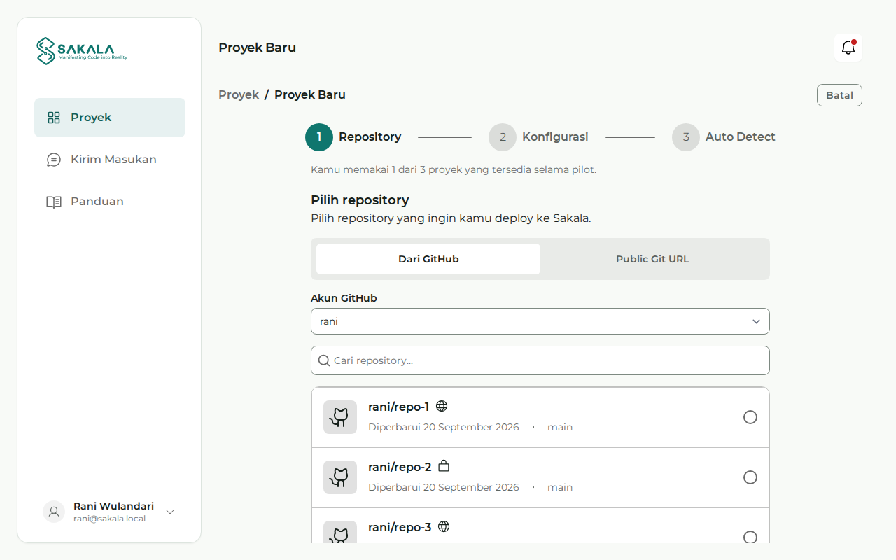

# Deploy Pertamamu

Di akhir panduan ini, repository-mu sudah menjadi aplikasi dengan URL publik, kamu tahu cara membaca status dan log-nya, dan kamu sudah pernah melakukan redeploy. Sisihkan kira-kira 30 menit untuk pertama kali. Angka itu perkiraan kami, bukan hasil pengukuran.

> **Status per 6 November 2026.** Sakala belum dibuka untuk umum, jadi panduan ini hanya untuk peserta pilot yang diundang. Langkah di bawah ditulis dari kode Console terbaru, tetapi belum dicoba bersama pengguna pilot dan belum diuji di production. Sakala belum siap untuk aplikasi production, dan tidak ada jaminan uptime atau waktu respons.

## Untuk siapa

Panduan ini untuk mahasiswa dan developer pemula yang belum pernah men-deploy lewat Sakala. Kamu tidak perlu mengurus server. Yang perlu kamu pahami hanya cara memakai Git dan cara menjalankan aplikasimu sendiri.

## Yang perlu disiapkan

- **Undangan pilot.** Tanpa undangan, kamu belum bisa memakai Sakala.
- **Akun GitHub dan satu repository.** Repository publik bisa langsung dipakai. Repository private harus dihubungkan lewat GitHub App.
- **Aplikasi web yang mendengarkan di `0.0.0.0:$PORT`,** dengan alamat `/` yang menjawab di bawah status 500.

Belum punya aplikasi? Salin contoh kecil di [Menyiapkan Dockerfile](/docs/dockerfile), lalu push ke GitHub. Repository dengan Dockerfile memakai Dockerfile itu, dan repository tanpa Dockerfile dibangun otomatis oleh Railpack. Sakala belum menyediakan database, jadi kalau aplikasimu butuh database, baca dulu [Menghubungkan database eksternal](/docs/database-eksternal).

Selama pilot, satu akun punya 3 proyek. Aplikasi berjalan dengan memory 256 MB dan CPU 0,5 vCPU, dan build dibatasi 10 menit.

## Langkah 1: daftar dan verifikasi email

Buka Console di `app.sakala.dev`. Kalau belum punya akun, buka halaman **Daftar** lalu pilih **Buat akun dengan Github**, **Google**, atau **Email**.

Kalau memilih email, isi email, nama lengkap, dan kata sandi minimal 8 karakter, lalu tekan **Buat Akun**. Buka tautan verifikasi yang kami kirim, lalu masuk dengan **Lanjutkan dengan Email**.

**Yang seharusnya terlihat:** setelah tautan dibuka, muncul **Verifikasi Email Berhasil**. Setelah masuk, kamu langsung dibawa ke onboarding.

Email tidak datang? Cek folder spam, lalu tekan **Kirim ulang email verifikasi**.

## Langkah 2: selesaikan onboarding

Ada tiga layar: **Dari mana kamu mengetahui Sakala?**, **Pengaturan Profil**, dan **Siap Membangun**. Dua layar pertama boleh dilewati dengan **Lewati**. Tekan **Lanjutkan** di layar terakhir.

**Yang seharusnya terlihat:** halaman **Proyek** dengan kartu **Buat Proyek Baru**, karena kamu belum punya proyek.

## Langkah 3: pilih repository

Tekan **Mulai Sekarang** di kartu tadi. Kamu masuk ke `/projects/new`, dengan tiga tahap di atas: **Repository**, **Konfigurasi**, dan **Auto Detect**.



_Gambar ilustrasi dengan data contoh, bukan akun atau repository sungguhan._

Ada dua cara memilih:

- **Dari GitHub.** Tekan **Hubungkan GitHub**, pasang GitHub App Sakala, dan pilih repository yang boleh dibaca. Setelah kembali ke halaman ini, pilih repository-nya lalu tekan **Lanjut**. Cara ini juga untuk repository private.
- **Public Git URL.** Tempel alamat seperti `https://github.com/username/nama-repo.git`, lalu tekan **Lanjut**. Repository-nya harus bisa dibuka tanpa login. Cara ini tidak mendukung auto-deploy.

**Yang seharusnya terlihat:** layar **Persiapan deployment**, dengan nama repository-mu di bagian atas.

## Langkah 4: isi konfigurasi

Untuk deploy pertama, biasanya hanya **Nama Proyek** dan **Branch** yang perlu kamu periksa. Biarkan yang opsional kosong kalau kamu belum butuh.

| Kolom                            | Isinya                                                                                                                       |
| -------------------------------- | ---------------------------------------------------------------------------------------------------------------------------- |
| Nama Proyek                      | Diambil dari nama repository. **Domain preview** di bawahnya menunjukkan calon alamatmu, tetapi alamat itu belum dipesan.    |
| Branch                           | Branch yang akan di-deploy. Pilih dari daftar.                                                                               |
| Port (opsional)                  | Port yang diberikan Sakala lewat variabel `PORT`. Kosong berarti 3000.                                                       |
| Build command (opsional)         | Hanya untuk build otomatis dengan Railpack. Diabaikan kalau ada Dockerfile.                                                  |
| Start command (opsional)         | Berlaku untuk keduanya. Pada Dockerfile, ini menggantikan entrypoint image, jadi image-nya harus punya `sh`.                 |
| Root directory (opsional)        | Folder aplikasi di dalam repository, misalnya `apps/web`. Kosongkan kalau aplikasinya ada di root.                           |
| Environment Variables (opsional) | Pasangan nama dan nilai. **Simpan sebagai rahasia** menyembunyikan nilainya setelah disimpan. Jangan menambahkan `PORT`.     |
| Auto-deploy                      | Membuat deployment baru setiap kali kamu push ke branch ini. Hanya untuk **Dari GitHub**. Biarkan mati untuk deploy pertama. |

Jangan menulis password atau token di repository. Tempatnya di Environment Variables. Setelah semuanya benar, tekan **Buat Proyek**.

**Yang seharusnya terlihat:** tahap **Auto Detect** dengan judul **Sakala membaca proyekmu**. Proyeknya sudah dibuat, jadi jangan membuatnya lagi kalau kamu menutup halaman ini. Kalau muncul **Proyek sudah dibuat, tapi N variabel belum tersimpan**, dengan N berupa jumlah variabelnya, perbaiki lalu tekan **Simpan ulang variabel**.

## Langkah 5: periksa hasil Auto Detect

Sakala memeriksa repository-mu di server. Analisis pertama bisa makan waktu satu menit atau lebih, dan halaman ini boleh ditinggal.

**Yang seharusnya terlihat:** daftar **Repository**, **Branch**, **Port**, **Builder**, **Framework**, dan **Package manager**, serta calon alamatmu. Alamat itu baru aktif setelah deploy pertama berhasil.

Periksa dua hal berikut sebelum lanjut:

- **Builder.** Kalau repository-mu punya Dockerfile, baris ini harus berbunyi **Dockerfile terdeteksi**. Kalau tidak, lihat [Dockerfile tidak terpakai](/docs/deploy-gagal#dockerfile-tidak-terpakai).
- **Port.** Aplikasimu harus mendengarkan di port ini. Yang paling aman adalah membaca `PORT` di kode.

Kalau muncul catatan soal `.env.example`, cocokkan isinya dengan variabel di tab **Environment Variables**. Kalau analisis gagal, tekan **Detect ulang**. Kalau setelah 2 menit analisisnya belum selesai, kamu tetap boleh lanjut, karena Sakala memilih cara build saat deploy.

Lalu tekan **Deploy sekarang**. Tombol **Lewati** menyimpan proyek tanpa men-deploy-nya, dan kamu bisa men-deploy-nya nanti dari halaman proyek.

## Langkah 6: pantau deployment

Kamu dibawa ke halaman detail deployment. Halaman ini boleh ditinggal, karena deployment berjalan di server.

**Yang seharusnya terlihat:**

- **Banner status.** **Deployment mengantre** berarti deployment menunggu server. **Deployment sedang berjalan** menyebut tahap yang sedang dikerjakan.
- **Timeline,** dengan tahap Menunggu antrean, Menyalin repository, Build proyek, Deploy proyek, Mengecek aplikasi, dan Menyiapkan routing. Build dengan Railpack juga melewati Menganalisis proyek.
- **Logs,** yang bertambah selama deployment berjalan. Awalnya mungkin hanya tertulis **Menunggu log...**.

Tahap **Mengecek aplikasi** mengirim permintaan ke `/`. Status di bawah 500 berarti lolos. Baru setelah itu Sakala mengalihkan trafik ke aplikasimu.

Hasil akhirnya adalah salah satu dari ini:

- **Deployment berhasil,** dengan tulisan **perubahan sudah live**, alamat publikmu, dan tombol **Kunjungi situs**. Lanjut ke langkah berikutnya.
- **Deployment gagal,** dengan kode kegagalan dan tombol **Lihat detail error**. Buka [Saat deploy gagal](/docs/deploy-gagal), lalu cari kodenya.

## Langkah 7: buka URL-mu

Tekan **Kunjungi situs**. Dari terminal, kamu juga bisa mengeceknya dengan perintah berikut. Ganti alamatnya dengan alamat proyekmu.

```bash
curl -I https://NAMA-PROYEK.run.sakala.dev/
```

**Yang seharusnya terlihat:** halaman aplikasimu di browser, dan status di bawah 500 di terminal. Pengecekan Sakala hanya memastikan aplikasimu menjawab, jadi tetap coba fitur-fiturnya sendiri.

## Langkah 8: lakukan redeploy

Ubah sesuatu yang mudah terlihat, misalnya sebuah teks, lalu push:

```bash
git add .
git commit -m "chore: ubah teks halaman utama"
git push
```

Buka halaman proyek, lalu tekan **Redeploy**.

**Yang seharusnya terlihat:** deployment baru dengan nomor berikutnya. Versi lama tetap melayani sampai versi baru lolos pengecekan. Setelah **Deployment berhasil**, muat ulang URL-mu dan perubahannya tampil. Kamu bisa melihat semua percobaan di tab **Riwayat Deployment**.

Perubahan di tab **Environment Variables** dan **Pengaturan** juga baru berlaku di deployment berikutnya, jadi tekan **Redeploy** setelah mengubahnya.

## Kalau ada yang macet

| Di mana                | Yang terlihat                               | Yang perlu dilakukan                                                                                                                                     |
| ---------------------- | ------------------------------------------- | -------------------------------------------------------------------------------------------------------------------------------------------------------- |
| Masuk                  | **Email atau kata sandi salah.**            | Periksa lagi, atau tekan **Lupa Kata Sandi?**                                                                                                            |
| Masuk                  | Email belum terverifikasi                   | Tekan **Kirim ulang email verifikasi**                                                                                                                   |
| Repository             | **Belum ada repository yang bisa dipilih**  | Tekan **Atur akses repository**, lalu beri akses ke repository-mu di GitHub                                                                              |
| Repository             | **Instalasi GitHub tidak aktif**            | Tekan **Hubungkan ulang GitHub**                                                                                                                         |
| Public Git URL         | Repository tidak bisa diperiksa             | Pastikan alamatnya benar dan bisa dibuka tanpa login, atau pakai **Dari GitHub**                                                                         |
| Deploy, ambil source   | Kode yang diawali `repository_`             | Lihat [Repository dan GitHub](/docs/deploy-gagal#repository-dan-github)                                                                                  |
| Deploy, build          | `runtime_build_failed`                      | Baca Logs, lalu lihat [`runtime_build_failed`](/docs/deploy-gagal#runtime_build_failed)                                                                  |
| Deploy, aplikasi mulai | `runtime_app_not_listening`                 | Lihat [`runtime_app_not_listening`](/docs/deploy-gagal#runtime_app_not_listening) dan [aturan port](/docs/dockerfile#kenapa-alamat-dan-port-itu-penting) |
| Deploy, antrean        | **Deployment mengantre** dan tidak bergerak | Lihat [Deployment tertahan di antrean](/docs/deploy-gagal#deployment-tertahan-di-antrean)                                                                |
| Aplikasi, database     | Halaman error, atau koneksi ditolak di Logs | Lihat [Kalau koneksinya gagal](/docs/database-eksternal#kalau-koneksinya-gagal)                                                                          |

Masih buntu? Lihat [Kegagalan yang belum dikenali](/docs/deploy-gagal#kegagalan-yang-belum-dikenali).

## Langkah berikutnya

Kamu sudah punya alur dasarnya. Berikutnya, pakai aplikasimu sendiri dengan bantuan [Menyiapkan Dockerfile](/docs/dockerfile), atau hubungkan data lewat [Menghubungkan database eksternal](/docs/database-eksternal). Kalau ada yang membingungkan selama pilot, ceritakan lewat menu **Kirim Masukan** di Console.
