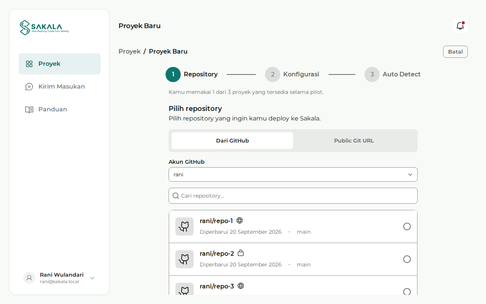

# Deploy Pertamamu

Di akhir panduan ini, repository-mu sudah menjadi aplikasi dengan URL publik, kamu tahu cara membaca status dan log-nya, dan kamu sudah pernah melakukan redeploy. Sisihkan kira-kira 30 menit untuk pertama kali. Angka itu perkiraan kami, bukan hasil pengukuran.

> **Status per 23 November 2026.** Sakala sedang dalam tahap pilot terbuka: siapa pun bisa mendaftar dan memakainya tanpa biaya, dengan batas pemakaian. Belum ada jaminan uptime atau waktu respons, jadi Sakala belum cocok untuk aplikasi yang penting. Langkah di bawah ditulis dari kode Console terbaru. Kalau tampilan di layarmu berbeda, ceritakan lewat menu **Kirim masukan** di Console.

## Untuk siapa

Panduan ini untuk mahasiswa dan developer pemula yang belum pernah men-deploy lewat Sakala. Kamu tidak perlu mengurus server. Yang perlu kamu pahami hanya cara memakai Git dan cara menjalankan aplikasimu sendiri.

## Yang perlu disiapkan

- **Akun GitHub dan satu repository.** Repository publik bisa langsung dipakai. Repository private harus dihubungkan lewat GitHub App.
- **Aplikasi web yang mendengarkan di `0.0.0.0:$PORT`,** dengan alamat `/` yang menjawab di bawah status 500.

Belum punya aplikasi? Kamu bisa mencoba salah satu contoh di wizard (langkah 3), atau menyalin contoh kecil di [Menyiapkan Dockerfile](/docs/dockerfile) lalu push ke GitHub. Repository dengan Dockerfile memakai Dockerfile itu, dan repository tanpa Dockerfile dibangun otomatis oleh Railpack. Kalau aplikasimu butuh database, baca dulu [Database Terkelola](/docs/database-terkelola), yang masih pilot terbatas, atau [Menghubungkan database eksternal](/docs/database-eksternal).

Selama pilot, workspace pribadimu punya 3 proyek. Aplikasi berjalan dengan memory 256 MB dan CPU 0,5 vCPU, build dibatasi 10 menit dan 20 kali per jam, dan proyek tidur setelah 30 menit tanpa pengunjung. Rinciannya ada di [Batas Pilot](/docs/batas-pilot).

## Langkah 1: daftar dan verifikasi email

Buka Console di `app.sakala.dev`. Kalau belum punya akun, buka halaman [**Daftar**](https://app.sakala.dev/register), lalu pilih **Daftar dengan GitHub**, **Daftar dengan Google**, atau isi formulir email di bawahnya.

Kalau memakai email, isi **Email**, **Nama lengkap**, **Kata sandi** (minimal 8 karakter), dan **Konfirmasi kata sandi**. Centang persetujuan [Syarat Layanan](/syarat) dan [Kebijakan Penggunaan Wajar](/penggunaan-wajar), lalu tekan **Buat akun**. Buka tautan verifikasi yang kami kirim, lalu tekan **Masuk**. Kalau mendaftar lewat GitHub atau Google, persetujuan yang sama diminta saat pertama kali masuk. Cara Sakala memproses datamu dijelaskan di [Pemberitahuan Privasi](/privasi).

**Yang seharusnya terlihat:** setelah tautan dibuka, muncul **Verifikasi email berhasil**. Setelah masuk, kamu dibawa ke layar **Selamat datang di Sakala**.

Email tidak datang? Cek folder spam, lalu tekan **Kirim ulang email verifikasi**.

## Langkah 2: mulai dari layar selamat datang

Layar **Selamat datang di Sakala** punya dua tombol: **Buat proyek pertama** dan **Lihat dashboard dulu**. Tekan **Buat proyek pertama**.

Belum punya repository? Tekan **Coba dulu dengan repo contoh** di bawahnya. Kamu dibawa ke daftar contoh yang sama dengan di langkah berikutnya.

**Yang seharusnya terlihat:** halaman **Proyek baru**, dengan tiga tahap di atas: **Repository**, **Konfigurasi**, dan **Deploy**.

## Langkah 3: pilih repository

Di tahap **Repository**, judulnya **Pilih repository**.



_Gambar ilustrasi dengan data contoh, bukan akun atau repository sungguhan._

Ada tiga cara memilih:

- **Dari GitHub.** Tekan **Hubungkan GitHub**, pasang GitHub App Sakala, dan pilih repository yang boleh dibaca. Setelah kembali ke halaman ini, pilih repository-nya. Cara ini juga untuk repository private, dan hanya cara ini yang mendukung auto-deploy.
- **URL GitHub publik.** Tempel alamat repository publik, misalnya `https://github.com/username/nama-repo`. Alamat dengan `.git`, garis miring di akhir, atau bentuk `username/nama-repo` juga diterima. Repository-nya harus bisa dibuka tanpa login.
- **Belum punya repo? Coba dengan contoh.** Pilih **Situs HTML statis**, **Node.js dan Express**, atau **Laravel**. Konfigurasinya langsung terisi, dan kamu langsung dibawa ke tahap berikutnya.

Kalau kamu anggota workspace tim, pilih juga **Workspace** tempat proyek ini disimpan. Proyek di workspace tim ikut dikelola pemilik dan anggota tim itu.

Lalu tekan **Lanjut**.

**Yang seharusnya terlihat:** layar **Persiapan deployment**, dengan nama repository-mu di bagian atas dan tautan **Ganti repository**.

## Langkah 4: periksa konfigurasi

Untuk deploy pertama, biasanya hanya **Nama proyek** dan **Branch** yang perlu kamu periksa. Port dan perintah dideteksi Sakala dari repository.

| Kolom                           | Isinya                                                                                                                                                 |
| ------------------------------- | ------------------------------------------------------------------------------------------------------------------------------------------------------ |
| Nama proyek                     | Diambil dari nama repository dan bisa diganti nanti. **Domain preview** di bawahnya menunjukkan calon alamatmu, tetapi alamat itu belum dipesan.       |
| Branch                          | Branch yang akan di-deploy. Pilih dari daftar. Kalau daftarnya terpotong dan branch-mu tidak ada, ketik namanya lengkap.                               |
| Environment variable (opsional) | Pasangan nama dan nilai, atau isi `.env` lewat **Tempel dari .env**. Centang **Simpan sebagai secret** untuk nilai rahasia. Jangan menambahkan `PORT`. |
| Auto-deploy                     | Membuat deployment baru setiap kali kamu push ke branch ini. Hanya untuk repository dari GitHub App. Biarkan mati untuk deploy pertama kalau ragu.     |

**Pengaturan lanjutan** berisi Port, Build command, Start command, Release command, dan Root directory. Semuanya boleh dikosongkan, karena Sakala mendeteksi port dan perintah dari repository. Release command tidak dideteksi: isi kalau aplikasimu perlu menjalankan migration, lihat [Database dan Perintah Rilis](/docs/perintah-rilis). Root directory dipakai kalau aplikasinya ada di subfolder, misalnya `apps/web`; lihat [Men-deploy monorepo](/docs/monorepo).

Jangan menulis password atau token di repository. Tempatnya di environment variable, lihat [Variabel dan Secret](/docs/variabel-dan-secret).

Di bawah ada dua tombol:

- **Buat dan deploy** membuat proyek dan memulai deploy pertama sendiri, begitu port aplikasimu diketahui.
- **Buat tanpa deploy** hanya membuat proyek, menyimpan variabelnya, dan membuka halaman proyek. Kamu bisa men-deploy-nya nanti dari sana.

Tekan **Buat dan deploy**. Kalau muncul **Proyek sudah dibuat, tapi N variabel belum tersimpan**, dengan N berupa jumlah variabelnya, perbaiki lalu tekan **Simpan ulang variabel**, atau **Lanjut tanpa variabel ini**. Proyeknya sudah dibuat, jadi jangan membuatnya lagi.

## Langkah 5: tahap Deploy

Tahap **Deploy** berjudul **Deploy pertama**. Sakala membaca repository-mu di server. Analisis pertama bisa makan waktu satu menit atau lebih, dan halaman ini boleh ditinggal.

Yang terjadi berikutnya tergantung hasilnya:

- **Tidak ada yang perlu dikonfirmasi.** Deploy pertama dimulai sendiri, dan kamu dibawa ke halaman deployment.
- **Ada yang perlu dikonfirmasi.** Muncul tahap **Persiapan**, diawali kalimat seperti **Sakala sudah membaca nama-proyek dan menyiapkan 12 variabel. Tinggal pilihan database dan 2 variabel yang perlu kamu isi.** Isinya:
  - saran variabel dari `.env.example`, dikelompokkan menjadi **Perlu kamu isi**, **Dibuatkan Sakala**, **Dari .env.example**, dan **Diisi Sakala**. Rinciannya ada di [Variabel dan Secret](/docs/variabel-dan-secret#mengisi-variabel-saat-membuat-proyek);
  - kalau aplikasimu terlihat butuh database, kartu **Aplikasi ini sepertinya butuh database** dengan pilihan **Buat database baru untuk proyek ini**, **Pakai database yang sudah ada**, atau **Tanpa database**. Database terkelola masih pilot terbatas, jadi kebanyakan workspace hanya bisa memilih **Tanpa database**. Lihat [Database Terkelola](/docs/database-terkelola).

  Periksa, lalu tekan **Deploy sekarang**. Kalau kamu memilih database baru, Sakala menyiapkannya dulu dan deploy dimulai sendiri setelah database siap.

- **Analisis gagal.** Tekan **Deteksi ulang**. Kalau analisis masih berjalan setelah 2 menit, kamu tetap boleh menekan **Deploy sekarang**, karena Sakala memilih cara build saat deploy.

Di bagian **Hasil deteksi** kamu bisa melihat **Repository**, **Branch**, **Port**, **Builder**, **Framework**, dan **Package manager**, serta calon alamatmu. Alamat itu baru aktif setelah deploy pertama berhasil. Periksa dua hal:

- **Builder.** Kalau repository-mu punya Dockerfile, baris ini harus berbunyi **Dockerfile terdeteksi**. Kalau tidak, lihat [Dockerfile tidak terpakai](/docs/deploy-gagal#dockerfile-tidak-terpakai).
- **Port.** Aplikasimu harus mendengarkan di port ini. Yang paling aman adalah membaca `PORT` di kode.

## Langkah 6: pantau deployment

Kamu dibawa ke halaman detail deployment. Halaman ini boleh ditinggal, karena deployment berjalan di server.

**Yang seharusnya terlihat:**

- **Banner status.** **Deployment mengantre** berarti deployment menunggu server. **Deployment sedang berjalan** menyebut tahap yang sedang dikerjakan.
- **Timeline,** dengan tahap Menunggu antrean, Menyalin repository, Build proyek, Deploy proyek, Mengecek aplikasi, dan Menyiapkan routing. Build dengan Railpack juga melewati Menganalisis proyek.
- **Logs,** yang bertambah selama deployment berjalan. Awalnya mungkin hanya tertulis **Menunggu log...**.

Tahap **Mengecek aplikasi** mengirim permintaan ke `/`. Status di bawah 500 berarti lolos. Baru setelah itu Sakala mengalihkan trafik ke aplikasimu.

Hasil akhirnya adalah salah satu dari ini:

- **Berhasil.** Untuk deploy pertama, judulnya **nama-proyek sudah live**, dengan alamat publikmu dan tombol **Buka situs**, **Salin**, **Bagikan**, dan **Kode QR**. **Bagikan** membuka menu berbagi di perangkat yang mendukungnya, dan **Kode QR** memudahkan membuka alamatnya dari HP. Lanjut ke langkah berikutnya.
- **Gagal,** dengan kode kegagalan, tombol **Lihat error di log**, dan **Salin ringkasan error** untuk dikirim saat minta bantuan. Buka [Saat deploy gagal](/docs/deploy-gagal), lalu cari kodenya.

Di halaman ini kamu mungkin juga melihat pertanyaan **Dari mana kamu tahu Sakala?**. Boleh dijawab atau dilewati.

## Langkah 7: buka URL-mu

Tekan **Buka situs**. Dari terminal, kamu juga bisa mengeceknya dengan perintah berikut. Ganti alamatnya dengan alamat proyekmu.

```bash
curl -I https://NAMA-PROYEK.sakala.app/
```

**Yang seharusnya terlihat:** halaman aplikasimu di browser, dan status di bawah 500 di terminal. Pengecekan Sakala hanya memastikan aplikasimu menjawab, jadi tetap coba fitur-fiturnya sendiri.

## Langkah 8: lakukan redeploy

Ubah sesuatu yang mudah terlihat, misalnya sebuah teks, lalu push:

```bash
git add .
git commit -m "chore: ubah teks halaman utama"
git push
```

Kalau auto-deploy menyala, push itu sudah membuat deployment baru. Kalau tidak, buka halaman proyek lalu tekan **Redeploy**.

**Yang seharusnya terlihat:** deployment baru dengan nomor berikutnya. Versi lama tetap melayani sampai versi baru lolos pengecekan. Setelah **Deployment berhasil**, muat ulang URL-mu dan perubahannya tampil. Semua percobaan ada di tab **Riwayat**.

Perubahan di tab **Variabel** dan **Pengaturan** juga baru berlaku di deployment berikutnya, jadi tekan **Redeploy** setelah mengubahnya. Kalau yang berubah hanya variabel yang dibaca saat aplikasi berjalan, Redeploy memakai ulang image yang sama tanpa build. Aturannya ada di [Variabel dan Secret](/docs/variabel-dan-secret#variabel-saat-build-dan-saat-aplikasi-berjalan).

## Kalau ada yang macet

| Di mana                | Yang terlihat                               | Yang perlu dilakukan                                                                                                                                     |
| ---------------------- | ------------------------------------------- | -------------------------------------------------------------------------------------------------------------------------------------------------------- |
| Masuk                  | **Email atau kata sandi salah.**            | Periksa lagi, atau tekan **Lupa kata sandi?**                                                                                                            |
| Masuk                  | Email belum terverifikasi                   | Tekan **Kirim ulang email verifikasi**                                                                                                                   |
| Repository             | **Belum ada repository yang bisa dipilih**  | Tekan **Atur akses repository**, lalu beri akses ke repository-mu di GitHub                                                                              |
| Repository             | **Instalasi GitHub tidak aktif**            | Tekan **Hubungkan ulang GitHub**                                                                                                                         |
| URL GitHub publik      | Repository tidak bisa diperiksa             | Pastikan alamatnya benar dan bisa dibuka tanpa login, atau pakai **Dari GitHub**                                                                         |
| Deploy, ambil source   | Kode yang diawali `repository_`             | Lihat [Repository dan GitHub](/docs/deploy-gagal#repository-dan-github)                                                                                  |
| Deploy, build          | `runtime_build_failed`                      | Baca Logs, lalu lihat [`runtime_build_failed`](/docs/deploy-gagal#runtime_build_failed)                                                                  |
| Deploy, aplikasi mulai | `runtime_app_not_listening`                 | Lihat [`runtime_app_not_listening`](/docs/deploy-gagal#runtime_app_not_listening) dan [aturan port](/docs/dockerfile#kenapa-alamat-dan-port-itu-penting) |
| Deploy, antrean        | **Deployment mengantre** dan tidak bergerak | Lihat [Deployment tertahan di antrean](/docs/deploy-gagal#deployment-tertahan-di-antrean)                                                                |
| Aplikasi, database     | Halaman error, atau koneksi ditolak di Logs | Lihat [Kalau koneksinya gagal](/docs/database-eksternal#kalau-koneksinya-gagal)                                                                          |

Masih buntu? Lihat [Kegagalan yang belum dikenali](/docs/deploy-gagal#kegagalan-yang-belum-dikenali).

## Langkah berikutnya

Kamu sudah punya alur dasarnya. Berikutnya, pakai aplikasimu sendiri dengan bantuan [Menyiapkan Dockerfile](/docs/dockerfile), atau hubungkan data lewat [Database Terkelola](/docs/database-terkelola) atau [Menghubungkan database eksternal](/docs/database-eksternal). Kalau ada yang membingungkan selama pilot, ceritakan lewat menu **Kirim masukan** di Console.
