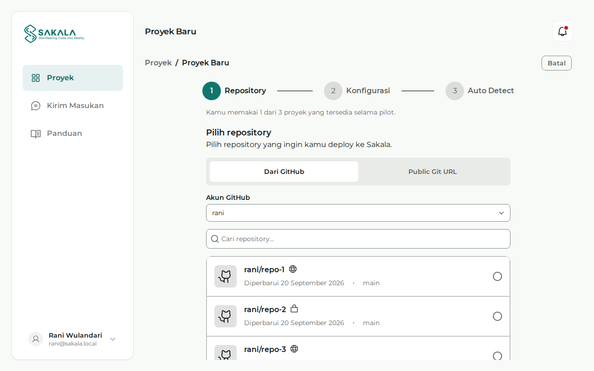

# Your First Deploy

By the end of this guide your repository is an application with a public URL, you know how to read its status and logs, and you have done a redeploy. Set aside about 30 minutes the first time. That figure is our estimate, not a measurement.

> **Status as of 23 November 2026.** Sakala is in an open pilot: anyone can sign up and use it at no cost, within usage limits. There is no uptime or response time guarantee yet, so Sakala is not a fit for important applications. The steps below were written from the latest Console code. If your screen looks different, tell us through the **Kirim masukan** (send feedback) menu in the Console. The Console is in Indonesian, so its labels are quoted as they appear on screen.

## Who this is for

This guide is for students and beginner developers who have not deployed through Sakala before. You do not have to manage a server. You only need to know how to use Git and how to run your own application.

## What you need

- **A GitHub account and one repository.** A public repository works right away. A private one has to be connected through the GitHub App.
- **A web application listening on `0.0.0.0:$PORT`,** whose `/` answers with a status under 500.

No application yet? You can try one of the examples in the wizard (step 3), or copy the small example in [Preparing a Dockerfile](/en/docs/dockerfile) and push it to GitHub. A repository with a Dockerfile uses that Dockerfile, and one without is built automatically by Railpack. If your application needs a database, read [Managed Databases](/en/docs/database-terkelola), still a limited pilot, or [Connecting an external database](/en/docs/database-eksternal) first.

During the pilot, your personal workspace has 3 projects. Applications run with 256 MB of memory and 0.5 vCPU, builds are limited to 10 minutes and 20 per hour, and projects sleep after 30 minutes without visitors. The details are in [Pilot Limits](/en/docs/batas-pilot).

## Step 1: sign up and verify your email

Open the Console at `app.sakala.dev`. If you do not have an account yet, open the [**Daftar**](https://app.sakala.dev/register) (sign up) page, then choose **Daftar dengan GitHub** (sign up with GitHub), **Daftar dengan Google**, or fill in the email form below them.

With email, fill in **Email**, **Nama lengkap** (full name), **Kata sandi** (password, at least 8 characters), and **Konfirmasi kata sandi** (confirm password). Tick the consent to the [Terms of Service](/en/syarat) and the [Acceptable Use Policy](/en/penggunaan-wajar), then press **Buat akun** (create account). Open the verification link we send you, then press **Masuk** (sign in). If you sign up with GitHub or Google, the same consent is asked the first time you sign in. How Sakala processes your data is explained in the [Privacy Notice](/en/privasi).

**What you should see:** after opening the link, **Verifikasi email berhasil** (email verified). After signing in, you land on the **Selamat datang di Sakala** (welcome to Sakala) screen.

No email? Check your spam folder, then press **Kirim ulang email verifikasi** (resend the verification email).

## Step 2: start from the welcome screen

The **Selamat datang di Sakala** screen has two buttons: **Buat proyek pertama** (create your first project) and **Lihat dashboard dulu** (see the dashboard first). Press **Buat proyek pertama**.

No repository yet? Press **Coba dulu dengan repo contoh** (try an example repo first) below them. It takes you to the same examples as the next step.

**What you should see:** the **Proyek baru** (new project) page, with three stages at the top: **Repository**, **Konfigurasi** (configuration), and **Deploy**.

## Step 3: choose a repository

The **Repository** stage is titled **Pilih repository** (choose a repository).



_Illustration with sample data, not a real account or repository._

There are three ways to choose:

- **Dari GitHub** (from GitHub). Press **Hubungkan GitHub** (connect GitHub), install the Sakala GitHub App, and choose which repositories it may read. Back on this page, choose the repository. This is also the way for a private repository, and the only way that supports auto-deploy.
- **URL GitHub publik** (public GitHub URL). Paste the address of a public repository, for example `https://github.com/username/repo-name`. Addresses with `.git`, a trailing slash, or the `username/repo-name` form are accepted too. The repository has to open without logging in.
- **Belum punya repo? Coba dengan contoh** (no repo yet? try an example). Choose **Situs HTML statis** (static HTML site), **Node.js dan Express**, or **Laravel**. Its configuration is filled in, and you go straight to the next stage.

If you belong to a team workspace, also choose the **Workspace** the project is kept in. A project in a team workspace is managed by that team's owners and members too.

Then press **Lanjut** (next).

**What you should see:** the **Persiapan deployment** (deployment preparation) screen, with your repository's name at the top and a **Ganti repository** (change repository) link.

## Step 4: check the configuration

For a first deploy, usually only **Nama proyek** (project name) and **Branch** need checking. Sakala detects the port and commands from the repository.

| Field                           | What it holds                                                                                                                                                                |
| ------------------------------- | ---------------------------------------------------------------------------------------------------------------------------------------------------------------------------- |
| Nama proyek                     | Taken from the repository name and can be changed later. **Domain preview** below it shows your future address, but that address is not reserved yet.                        |
| Branch                          | The branch to deploy. Choose it from the list. If the list is cut off and your branch is missing, type its full name.                                                        |
| Environment variable (opsional) | Name and value pairs, or a `.env` file through **Tempel dari .env** (paste from .env). Tick **Simpan sebagai secret** (save as secret) for secret values. Do not add `PORT`. |
| Auto-deploy                     | Creates a new deployment every time you push to this branch. Only for repositories from the GitHub App. Leave it off for the first deploy if unsure.                         |

**Pengaturan lanjutan** (advanced settings) holds Port, Build command, Start command, Release command, and Root directory. They may all stay empty, because Sakala detects the port and commands from the repository. The release command is not detected: fill it in if your application needs to run migrations, see [Databases and the Release Command](/en/docs/perintah-rilis). Root directory is for an application in a subfolder, for example `apps/web`; see [Deploying a Monorepo](/en/docs/monorepo).

Do not write passwords or tokens in the repository. They belong in environment variables; see [Variables and Secrets](/en/docs/variabel-dan-secret).

There are two buttons at the bottom:

- **Buat dan deploy** (create and deploy) creates the project and starts the first deploy by itself, as soon as your application's port is known.
- **Buat tanpa deploy** (create without deploying) only creates the project, saves its variables, and opens the project page. You can deploy it from there later.

Press **Buat dan deploy**. If **Proyek sudah dibuat, tapi N variabel belum tersimpan** (the project was created, but N variables were not saved) appears, where N is the number of variables, fix them and press **Simpan ulang variabel** (save the variables again), or **Lanjut tanpa variabel ini** (continue without these variables). The project already exists, so do not create it again.

## Step 5: the Deploy stage

The **Deploy** stage is titled **Deploy pertama** (first deploy). Sakala reads your repository on the server. The first analysis can take a minute or more, and you may leave this page.

What happens next depends on the result:

- **Nothing to confirm.** The first deploy starts by itself, and you are taken to the deployment page.
- **Something to confirm.** A **Persiapan** (preparation) phase appears, opening with a sentence such as **Sakala sudah membaca project-name dan menyiapkan 12 variabel. Tinggal pilihan database dan 2 variabel yang perlu kamu isi.** (Sakala has read project-name and prepared 12 variables. What is left is the database choice and 2 variables you need to fill in.) It holds:
  - suggested variables from `.env.example`, in the groups **Perlu kamu isi**, **Dibuatkan Sakala**, **Dari .env.example**, and **Diisi Sakala**. The details are in [Variables and Secrets](/en/docs/variabel-dan-secret#setting-variables-while-creating-a-project);
  - if your application looks like it needs a database, a card **Aplikasi ini sepertinya butuh database** (this application seems to need a database) with **Buat database baru untuk proyek ini** (create a new database for this project), **Pakai database yang sudah ada** (use an existing database), or **Tanpa database** (no database). Managed databases are still a limited pilot, so most workspaces can only choose **Tanpa database**. See [Managed Databases](/en/docs/database-terkelola).

  Check them, then press **Deploy sekarang** (deploy now). If you chose a new database, Sakala prepares it first and the deploy starts by itself once the database is ready.

- **Analysis failed.** Press **Deteksi ulang** (detect again). If the analysis is still running after 2 minutes, you may still press **Deploy sekarang**, because Sakala chooses how to build at deploy time.

Under **Hasil deteksi** (detection result) you can see **Repository**, **Branch**, **Port**, **Builder**, **Framework**, and **Package manager**, plus your future address. That address only becomes active after the first deploy succeeds. Check two things:

- **Builder.** If your repository has a Dockerfile, this row must read **Dockerfile terdeteksi** (Dockerfile detected). If not, see [Dockerfile not used](/en/docs/deploy-gagal#dockerfile-not-used).
- **Port.** Your application must listen on this port. The safest way is to read `PORT` in your code.

## Step 6: watch the deployment

You are taken to the deployment detail page. You may leave this page, because the deployment runs on the server.

**What you should see:**

- **A status banner.** **Deployment mengantre** means it is waiting for a server. **Deployment sedang berjalan** names the stage in progress.
- **Timeline,** with the stages Menunggu antrean (queued), Menyalin repository (copying the repository), Build proyek (build), Deploy proyek (deploy), Mengecek aplikasi (checking the application), and Menyiapkan routing (preparing the route). Railpack builds also pass through Menganalisis proyek (analysing).
- **Logs,** which grow while the deployment runs. At first it may only read **Menunggu log...** (waiting for logs).

The **Mengecek aplikasi** stage sends a request to `/`. A status under 500 passes. Only then does Sakala move traffic to your application.

The end result is one of these:

- **Succeeded.** For a first deploy, the title reads **project-name sudah live** (project-name is live), with your public address and the buttons **Buka situs** (open site), **Salin** (copy), **Bagikan** (share), and **Kode QR** (QR code). **Bagikan** opens the share menu on devices that have one, and **Kode QR** makes it easy to open the address on a phone. Move on to the next step.
- **Failed,** with a failure code, a **Lihat error di log** (view the error in the log) button, and **Salin ringkasan error** (copy the error summary) for when you ask for help. Open [When a deploy fails](/en/docs/deploy-gagal) and look up the code.

On this page you may also see the question **Dari mana kamu tahu Sakala?** (how did you hear about Sakala?). You may answer or skip it.

## Step 7: open your URL

Press **Buka situs**. You can also check from a terminal with the command below. Replace the address with your project's.

```bash
curl -I https://PROJECT-NAME.sakala.app/
```

**What you should see:** your application in the browser, and a status under 500 in the terminal. Sakala's check only confirms your application answers, so still try its features yourself.

## Step 8: do a redeploy

Change something easy to spot, such as a piece of text, then push:

```bash
git add .
git commit -m "chore: change home page text"
git push
```

If auto-deploy is on, that push has already created a new deployment. If not, open the project page and press **Redeploy**.

**What you should see:** a new deployment with the next number. The old version keeps serving until the new one passes the check. After **Deployment berhasil**, reload your URL and the change appears. Every attempt is in the **Riwayat** (history) tab.

Changes in the **Variabel** (variables) and **Pengaturan** tabs also only apply from the next deployment, so press **Redeploy** after changing them. If only variables read while the application runs have changed, Redeploy reuses the same image without a build. The rules are in [Variables and Secrets](/en/docs/variabel-dan-secret#build-time-and-runtime-variables).

## If you get stuck

| Where                 | What you see                                                    | What to do                                                                                                                                                   |
| --------------------- | --------------------------------------------------------------- | ------------------------------------------------------------------------------------------------------------------------------------------------------------ |
| Login                 | **Email atau kata sandi salah.** (wrong email or password)      | Check again, or press **Lupa kata sandi?** (forgot password)                                                                                                 |
| Login                 | The email is not verified                                       | Press **Kirim ulang email verifikasi**                                                                                                                       |
| Repository            | **Belum ada repository yang bisa dipilih** (nothing to choose)  | Press **Atur akses repository** (manage repository access), then grant access on GitHub                                                                      |
| Repository            | **Instalasi GitHub tidak aktif** (GitHub installation inactive) | Press **Hubungkan ulang GitHub** (reconnect GitHub)                                                                                                          |
| URL GitHub publik     | The repository cannot be checked                                | Make sure the address is right and opens without logging in, or use **Dari GitHub**                                                                          |
| Deploy, fetching      | A code starting with `repository_`                              | See [Repository and GitHub](/en/docs/deploy-gagal#repository-and-github)                                                                                     |
| Deploy, build         | `runtime_build_failed`                                          | Read the Logs, then see [`runtime_build_failed`](/en/docs/deploy-gagal#runtime_build_failed)                                                                 |
| Deploy, app start     | `runtime_app_not_listening`                                     | See [`runtime_app_not_listening`](/en/docs/deploy-gagal#runtime_app_not_listening) and [the port rules](/en/docs/dockerfile#why-the-address-and-port-matter) |
| Deploy, queue         | **Deployment mengantre** and it does not move                   | See [A deployment stuck in the queue](/en/docs/deploy-gagal#a-deployment-stuck-in-the-queue)                                                                 |
| Application, database | An error page, or connections refused in the Logs               | See [If the connection fails](/en/docs/database-eksternal#if-the-connection-fails)                                                                           |

Still stuck? See [Unrecognised failures](/en/docs/deploy-gagal#unrecognised-failures).

## Next steps

You now have the basic flow. Next, use your own application with help from [Preparing a Dockerfile](/en/docs/dockerfile), or connect data through [Managed Databases](/en/docs/database-terkelola) or [Connecting an external database](/en/docs/database-eksternal). If anything confuses you during the pilot, tell us through the **Kirim masukan** (send feedback) menu in the Console.
