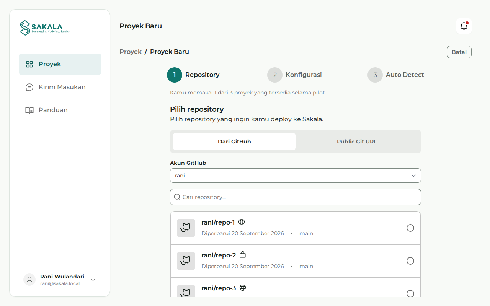

# Your First Deploy

By the end of this guide your repository is an application with a public URL, you know how to read its status and logs, and you have done a redeploy. Set aside about 30 minutes the first time. That figure is our estimate, not a measurement.

> **Status as of 6 November 2026.** Sakala is not open to the public yet, so this guide is only for invited pilot participants. The steps below were written from the latest Console code, but have not been tried with pilot users or tested in production. Sakala is not ready for production applications, and there is no uptime or response time guarantee. The Console is in Indonesian, so its labels are quoted as they appear on screen.

## Who this is for

This guide is for students and beginner developers who have not deployed through Sakala before. You do not have to manage a server. You only need to know how to use Git and how to run your own application.

## What you need

- **A pilot invitation.** Without one, you cannot use Sakala yet.
- **A GitHub account and one repository.** A public repository works right away. A private one has to be connected through the GitHub App.
- **A web application listening on `0.0.0.0:$PORT`,** whose `/` answers with a status under 500.

No application yet? Copy the small example in [Preparing a Dockerfile](/en/docs/dockerfile), then push it to GitHub. A repository with a Dockerfile uses that Dockerfile, and one without is built automatically by Railpack. Sakala does not provide a database yet, so if your application needs one, read [Connecting an external database](/en/docs/database-eksternal) first.

During the pilot, one account has 3 projects. Applications run with 256 MB of memory and 0.5 vCPU, and builds are limited to 10 minutes.

## Step 1: sign up and verify your email

Open the Console at `app.sakala.dev`. If you have no account, open the **Daftar** (sign up) page and choose **Buat akun dengan Github**, **Google**, or **Email**.

If you choose email, enter your email, full name, and a password of at least 8 characters, then press **Buat Akun**. Open the verification link we send, then log in with **Lanjutkan dengan Email**.

When you sign up, or first log in with GitHub or Google, you are asked to accept the [Terms of Service](/en/syarat) and the [Acceptable Use Policy](/en/penggunaan-wajar). The [Privacy Notice](/en/privasi) explains how Sakala processes your data. All three are published in Indonesian, and the Indonesian text governs.

**What you should see:** after opening the link, **Verifikasi Email Berhasil** (email verified). After logging in, you are taken straight to onboarding.

No email? Check your spam folder, then press **Kirim ulang email verifikasi** (resend the verification email).

## Step 2: finish onboarding

There are three screens: **Dari mana kamu mengetahui Sakala?** (how you found Sakala), **Pengaturan Profil** (profile), and **Siap Membangun** (ready to build). You can skip the first two with **Lewati**. Press **Lanjutkan** (continue) on the last one.

**What you should see:** the **Proyek** (projects) page with a **Buat Proyek Baru** (create a new project) card, since you have no projects yet.

## Step 3: choose a repository

Press **Mulai Sekarang** (start now) on that card. You arrive at `/projects/new`, with three stages at the top: **Repository**, **Konfigurasi** (configuration), and **Auto Detect**.



_An illustration with sample data, not a real account or repository._

There are two ways to choose:

- **Dari GitHub** (from GitHub). Press **Hubungkan GitHub** (connect GitHub), install the Sakala GitHub App, and choose which repositories it may read. Back on this page, choose your repository and press **Lanjut** (next). This is also the way for private repositories.
- **Public Git URL.** Paste an address like `https://github.com/username/nama-repo.git`, then press **Lanjut**. The repository has to open without logging in. This way does not support auto-deploy.

**What you should see:** the **Persiapan deployment** (deployment preparation) screen, with your repository's name at the top.

## Step 4: fill in the configuration

For a first deploy, usually only **Nama Proyek** and **Branch** need checking. Leave the optional fields empty if you do not need them yet.

| Field                            | What goes in it                                                                                                       |
| -------------------------------- | --------------------------------------------------------------------------------------------------------------------- |
| Nama Proyek (project name)       | Taken from the repository name. **Domain preview** below it shows your likely address, which is not reserved yet.     |
| Branch                           | The branch to deploy. Choose from the list.                                                                           |
| Port (opsional)                  | The port Sakala passes through the `PORT` variable. Empty means 3000.                                                 |
| Build command (opsional)         | Only for automatic builds with Railpack. Ignored when there is a Dockerfile.                                          |
| Start command (opsional)         | Applies to both. With a Dockerfile it replaces the image's entrypoint, so the image needs `sh`.                       |
| Root directory (opsional)        | The application's folder inside the repository, such as `apps/web`. Leave it empty if the application is at the root. |
| Environment Variables (opsional) | Name and value pairs. **Simpan sebagai rahasia** (save as secret) hides the value once saved. Do not add `PORT`.      |
| Auto-deploy                      | Creates a new deployment on every push to this branch. Only with **Dari GitHub**. Leave it off for your first deploy. |

Do not write passwords or tokens in the repository. They belong in Environment Variables. When everything looks right, press **Buat Proyek** (create project).

**What you should see:** the **Auto Detect** stage, headed **Sakala membaca proyekmu** (Sakala is reading your project). The project now exists, so do not create it again if you close this page. If you see **Proyek sudah dibuat, tapi N variabel belum tersimpan** (the project exists, but N variables were not saved), fix them and press **Simpan ulang variabel** (save variables again).

## Step 5: check the Auto Detect result

Sakala inspects your repository on the server. The first analysis can take a minute or more, and you may leave this page.

**What you should see:** a list of **Repository**, **Branch**, **Port**, **Builder**, **Framework**, and **Package manager**, plus your likely address. That address only goes live after the first successful deploy.

Check two things before moving on:

- **Builder.** If your repository has a Dockerfile, this row should read **Dockerfile terdeteksi** (Dockerfile detected). If not, see [Dockerfile not used](/en/docs/deploy-gagal#dockerfile-not-used).
- **Port.** Your application has to listen on this port. The safest way is to read `PORT` in your code.

If a note about `.env.example` appears, compare it with the variables in the **Environment Variables** tab. If the analysis fails, press **Detect ulang** (detect again). If the analysis has not finished after 2 minutes, you may still continue, because Sakala chooses how to build at deploy time.

Then press **Deploy sekarang** (deploy now). **Lewati** (skip) keeps the project without deploying it, and you can deploy later from the project page.

## Step 6: watch the deployment

You are taken to the deployment detail page. You may leave this page, because the deployment runs on the server.

**What you should see:**

- **A status banner.** **Deployment mengantre** means it is waiting for a server. **Deployment sedang berjalan** names the stage in progress.
- **Timeline,** with the stages Menunggu antrean (queued), Menyalin repository (copying the repository), Build proyek (build), Deploy proyek (deploy), Mengecek aplikasi (checking the application), and Menyiapkan routing (preparing the route). Railpack builds also pass through Menganalisis proyek (analysing).
- **Logs,** which grow while the deployment runs. At first it may only read **Menunggu log...** (waiting for logs).

The **Mengecek aplikasi** stage sends a request to `/`. A status under 500 passes. Only then does Sakala move traffic to your application.

The end result is one of these:

- **Deployment berhasil** (succeeded), with the words **perubahan sudah live** (changes are live), your public address, and a **Kunjungi situs** (visit site) button. Move on to the next step.
- **Deployment gagal** (failed), with a failure code and a **Lihat detail error** (view error details) button. Open [When a deploy fails](/en/docs/deploy-gagal) and look up the code.

## Step 7: open your URL

Press **Kunjungi situs**. You can also check from a terminal with the command below. Replace the address with your project's.

```bash
curl -I https://PROJECT-NAME.run.sakala.dev/
```

**What you should see:** your application in the browser, and a status under 500 in the terminal. Sakala's check only confirms your application answers, so still try its features yourself.

## Step 8: do a redeploy

Change something easy to spot, such as a piece of text, then push:

```bash
git add .
git commit -m "chore: change home page text"
git push
```

Open the project page and press **Redeploy**.

**What you should see:** a new deployment with the next number. The old version keeps serving until the new one passes the check. After **Deployment berhasil**, reload your URL and the change appears. You can see every attempt in the **Riwayat Deployment** (deployment history) tab.

Changes in the **Environment Variables** and **Pengaturan** tabs also only apply from the next deployment, so press **Redeploy** after changing them.

## If you get stuck

| Where                 | What you see                                                    | What to do                                                                                                                                                   |
| --------------------- | --------------------------------------------------------------- | ------------------------------------------------------------------------------------------------------------------------------------------------------------ |
| Login                 | **Email atau kata sandi salah.** (wrong email or password)      | Check again, or press **Lupa Kata Sandi?** (forgot password)                                                                                                 |
| Login                 | The email is not verified                                       | Press **Kirim ulang email verifikasi**                                                                                                                       |
| Repository            | **Belum ada repository yang bisa dipilih** (nothing to choose)  | Press **Atur akses repository** (manage repository access), then grant access on GitHub                                                                      |
| Repository            | **Instalasi GitHub tidak aktif** (GitHub installation inactive) | Press **Hubungkan ulang GitHub** (reconnect GitHub)                                                                                                          |
| Public Git URL        | The repository cannot be checked                                | Make sure the address is right and opens without logging in, or use **Dari GitHub**                                                                          |
| Deploy, fetching      | A code starting with `repository_`                              | See [Repository and GitHub](/en/docs/deploy-gagal#repository-and-github)                                                                                     |
| Deploy, build         | `runtime_build_failed`                                          | Read the Logs, then see [`runtime_build_failed`](/en/docs/deploy-gagal#runtime_build_failed)                                                                 |
| Deploy, app start     | `runtime_app_not_listening`                                     | See [`runtime_app_not_listening`](/en/docs/deploy-gagal#runtime_app_not_listening) and [the port rules](/en/docs/dockerfile#why-the-address-and-port-matter) |
| Deploy, queue         | **Deployment mengantre** and it does not move                   | See [A deployment stuck in the queue](/en/docs/deploy-gagal#a-deployment-stuck-in-the-queue)                                                                 |
| Application, database | An error page, or connections refused in the Logs               | See [If the connection fails](/en/docs/database-eksternal#if-the-connection-fails)                                                                           |

Still stuck? See [Unrecognised failures](/en/docs/deploy-gagal#unrecognised-failures).

## Next steps

You now have the basic flow. Next, use your own application with help from [Preparing a Dockerfile](/en/docs/dockerfile), or connect data through [Connecting an external database](/en/docs/database-eksternal). If anything confuses you during the pilot, tell us through the **Kirim Masukan** (send feedback) menu in the Console.
